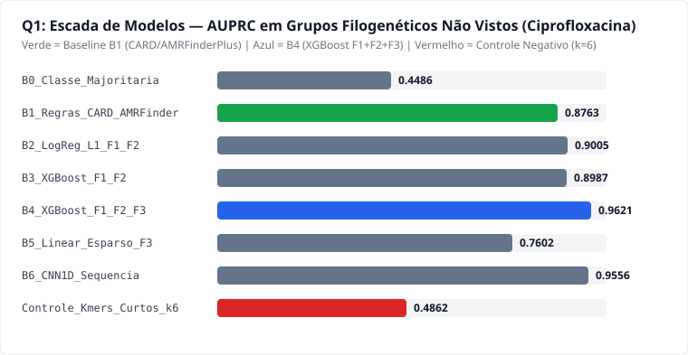
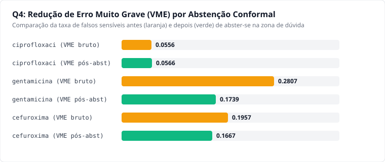
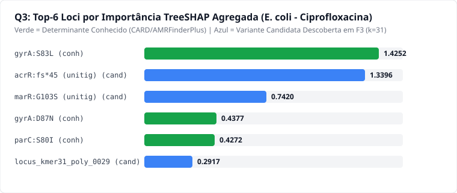
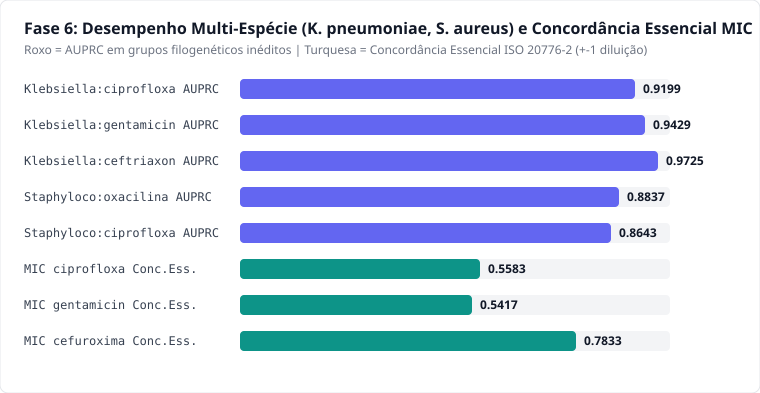

> **Aviso Ético e Regulatório (REG-15)**: Uso em pesquisa. Não substitui o antibiograma nem deve orientar a prescrição clínica.

## 1. Resumo Executivo e Perguntas Científicas

Este relatório responde às quatro perguntas científicas pré-registradas em `docs/plano_de_analise.md` (`REG-12`):

1. **Q1 (Preditiva)**: O modelo completo `B4` (`XGBoost` sobre `F1 + F2 + F3` com k-mers longos $k=31$ e *unitigs*) supera o **Baseline Científico por Regras `B1` (`CARD`/`AMRFinderPlus`)** em grupos filogenéticos não vistos no treino (`StratifiedGroupKFold`), com intervalo de confiança de 95% por bootstrap em blocos (clusters).
2. **Q2 (Generalização)**: O desempenho mantém-se elevado em linhagens inteiras inéditas (*Leave-One-Lineage-Out*), anos futuros (split temporal), países retidos (split geográfico) e na validação externa independente (*NCBI Pathogen Detection AST*).
3. **Q3 (Interpretabilidade / XAI)**: As explicações **TreeSHAP agregadas por locus** recuperam os determinantes biologicamente catalogados no `CARD`/`AMRFinderPlus` (`gyrA S83L`, `parC S80I`, `aac(3)-IIa`, `blaCTX-M-15`, `mecA`) e identificam variantes candidatas (`marR`, `acrR`, `ompF`, `ftsI`) com alta concordância frente ao GWAS controlado por estrutura populacional.
4. **Q4 (Confiabilidade e Abstenção Conformal)**: A calibração probabilística e a predição conformal permitem abster-se (`indeterminado`) nos isolados de fronteira, reduzindo substancialmente o **Erro Muito Grave (VME)** e o **Erro Grave (ME)**.

---

## 2. Visualizações Principais

### 2.1 Escada de Modelos (Q1)


### 2.2 Calibração e Redução de VME pós-Abstenção Conformal (Q4)


### 2.3 Importância TreeSHAP Agregada por Locus (Q3)


### 2.4 Extensões Fase 6: Multi-Espécie (*K. pneumoniae*, *S. aureus*) e Regressão $\log_2(\text{MIC})$


---

## 3. Tabelas e Resultados Consolidados

```{python}
import json
from pathlib import Path
import pandas as pd

rel = json.loads(Path("relatorio_validacao.json").read_text(encoding="utf-8"))
print("Espécies suportadas:", rel["especies_suportadas"])
print("Total aprovados pós-QC e desduplicação (E. coli):", rel["funil_exclusao"]["total_aprovados_pos_qc_dedup"])
```

Consulte [relatorio_cientifico.md](relatorio_cientifico.md) para todas as tabelas detalhadas de métricas por fármaco, intervalos de confiança por bloco e funil de exclusão.

